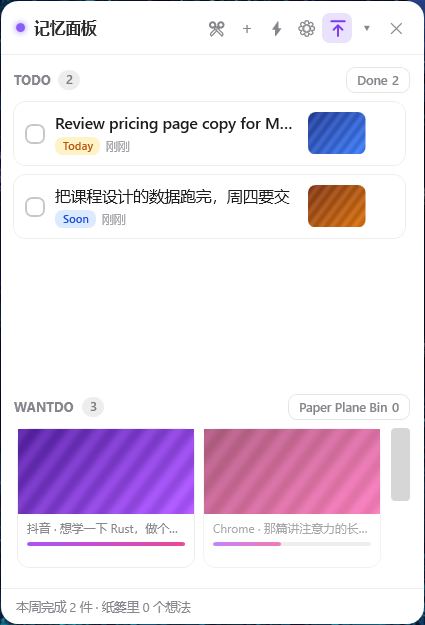
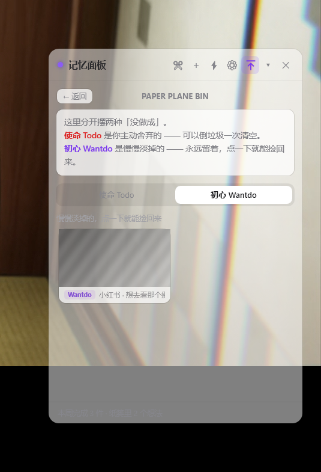
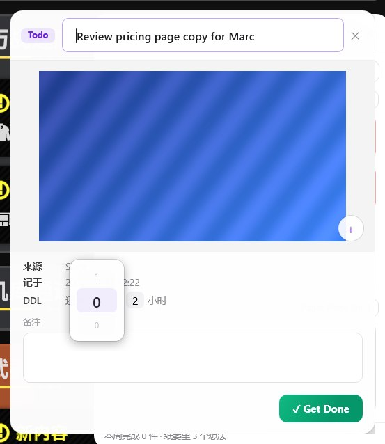
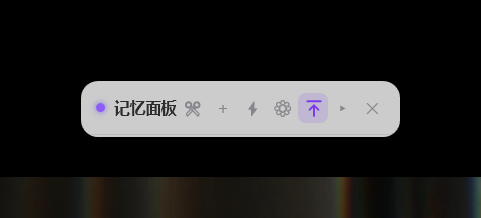
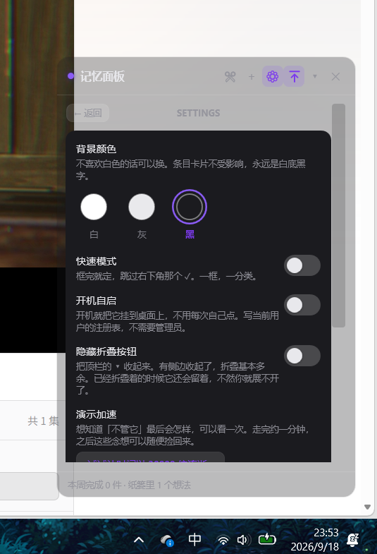

# Snip2Done · 设计手记

> **截图不是待办，是记忆钩子。**

一个常驻桌面的半透明小面板。看到一样以后要处理的东西，按 `Ctrl+Shift+A` 截下来，只做**一次**情感判断 —— 这是 **Todo** 还是 **Wantdo** —— 然后它就一直挂在你桌面上。

**Todo** 被 DDL 催着走；**Wantdo** 靠你的注意力续命：你不碰它，它就慢慢变淡，最后滑进 Paper Plane Bin，但永远能捞回来。

| | |
|---|---|
| 版本 | v0.9.3 |
| 技术栈 | 纯原生 WPF / XAML（.NET Framework 4.8） |
| 分发体积 | 一个 **235.5 KB** 的 exe，打包后 129.7 KB |
| 进程数 | **1** |
| 运行时依赖 | **零**（.NET Framework 4.8 是 Win10/11 自带的） |
| 网络请求 / 账号 / 模型调用 | **都没有** |



---

## 目录

- [一、它是什么](#一它是什么)
- [二、它要解决的问题](#二它要解决的问题)
- [三、六条设计理念](#三六条设计理念)
- [四、使用场景](#四使用场景)
- [五、那些小设计（一共 61 条）](#五那些小设计一共-61-条)
- [六、创新点](#六创新点)
- [七、为什么它值得被看见](#七为什么它值得被看见)
- [八、技术选型的取舍](#八技术选型的取舍)
- [九、数据与隐私](#九数据与隐私)
- [十、已知的边界](#十已知的边界)
- [附：文件地图与快捷键](#附文件地图与快捷键)

---

## 一、它是什么

一个**不弹窗**的待办 / 念想面板。常驻在桌面角落，半透明，不进任务栏。

它由两个**机制完全相反**的房间组成：

```
┌─────────────────────────────────────────┐
│  ● Snip2Done          ✂  ＋  ⚙  ⇧  ▾  ✕ │   ← 顶栏：常驻，永远在
├─────────────────────────────────────────┤
│  ⌕ Check                                 │   ← 搜索行
├─────────────────────────────────────────┤
│  TODO ④                        Done 26   │
│  ┌───────────────────────────────────┐   │
│  │ ○ 微信            [缩略图]  2天  │   │   ← 清单行，会随 DDL 变红
│  │ ○ 看它一眼      [缩略图]  Today  │   │   ← 永远不会变淡
│  └───────────────────────────────────┘   │
├─────────────────────────────────────────┤
│  WANTDO ④              Paper Plane Bin ⑫ │
│  ┌──────────┐ ┌──────────┐               │
│  │  大图    │ │  大图    │               │   ← 图片磁贴
│  │ 生命条 ▬ │ │ 生命条 ▬▬│               │   ← 不碰它就衰减
│  └──────────┘ └──────────┘               │
├─────────────────────────────────────────┤
│  本周完成 2 件 · 纸篓里 12 个想法        │   ← 底栏统计
└─────────────────────────────────────────┘
```

**捕获链路只有一个按键 + 一次情绪分类：**

```
看到某样东西
   ↓
Ctrl + Shift + A
   ↓
拖框选区（全屏压暗，只剩你框的那块亮着）
   ↓
   「这一张，是 Todo 还是 Wantdo？」
     ↓            ↓           ↓
  一天内        两三天      无期限
   (Today)      (Soon)     (Wantdo)
```

没有"选分类 + 填标题 + 填截止时间 + 选优先级 + 选标签"那一套表单。**这不是数据录入，是情绪分类** —— 而且它天然不会填错，因为你比任何 AI 都清楚自己刚才是焦虑还是心动。


---

## 二、它要解决的问题

### 待办软件的通病：愧疚纪念碑

所有待办软件最后都变成一座愧疚纪念碑。原因不是功能不够，而是**义务和愿望被塞进了同一个列表**：

- 你每看一眼，那些没做的愿望都在指责你；
- 「学吉他」和「周五交报告」睡在同一张床上，前者永远输；
- 列表越用越长，你越用越不想打开它。

### 解法：分开，而且用**相反**的机制

这两样东西本来就该住在不同的房间里。分开之后：

| | **Todo** | **Wantdo** |
|---|---|---|
| 驱动力 | **DDL 压力** —— 越拖越红 | **注意力衰减** —— 越不理它越淡 |
| 自动变化 | **绝不衰减**。任务不会因为你不看就消失，它只会逾期 | **必须衰减**。这就是它自我清洁的方式 |
| 终局 | 完成 / 逾期 | 完成 / 淡出 → 纸篓 / 主动放下 |
| 情感基调 | 责任、紧迫 | 温柔、无罪恶感 |
| 长什么样 | 清单行（勾选框 + 标题 + 小缩略图） | 图片磁贴（大图 + 来源 + 生命条） |

这个对立本身就是设计语言：**同一个界面里，左边的东西在催你，右边的东西在等你。**

而且这条不是文案上的修辞，是代码里的硬约束 —— 衰减只对 `room == "want"` 生效，巡检也只扫 Wantdo。**Todo 永远不会因为你不看它就进纸篓。**

### 它**不是**什么

先把边界说死，避免越做越糊：

| 它不是什么 | 为什么不做 |
|---|---|
| **不是截图工具** | Snipaste / PixPin / ShareX / flameshot 已经把这一层做满且免费。截图质量上打不过任何一个，不要竞争这一层。 |
| **不是「截图转待办」** | Capter 这类工具在 Win + Mac + Web 三端做完了「截图 → AI 起草标题 → 解析 by Friday → 三时点提醒 → 日历同步」这条轴。止步于此就是它的免费克隆。 |
| **不是全时屏幕记忆** | screenpipe / Windows Recall / 屏忆 已占满这条赛道，而且它们索引「时刻 / 帧」，不索引「意图」。 |
| **不做 OCR，不做 AI** | 见[理念一](#理念一不做-ocr不做-ai--因为再认强于回忆)。这不是省事，是产品定义。 |

**唯一且足够的差异点：**

1. **捕获时由人来标注时间意图**（「必须做 / 想做」这一步）—— 竞品里几乎全部缺失；
2. **以记忆为中心，而不是以任务为中心** —— 截图是主体，不是附件；
3. **纯本地、零模型、零配额** —— 没有 API 调用，没有「20 张/天」的上限。

---

## 三、六条设计理念

### 理念一：不做 OCR，不做 AI —— 因为再认强于回忆

你不需要「想起」你截过什么，你只需要**再看见它**。截图本身就是最好的检索键，信息量远超任何 OCR 文本或 AI 摘要。

所以「只存图片」不是妥协，是优势。砍掉 AI 有一连串连锁收益：

> 不需要模型 → 不需要 API → 不需要账号 → 不需要网络 → **没有配额** → 没有延迟 → 数据不出本机

别人的「20 张/天」上限不是产品设计选择，是**云端算力的成本结构**逼出来的。本地方案没有边际成本 —— 这是结构性差异，不是优化出来的。

**代价必须说清楚**：全文搜索没了。没有 OCR 就没有可搜的文本，这一条要主动放弃并**明确不承诺**。检索维度只剩：时间 / 来源软件 / 你选的档位 / 浮现。

> 唯一保留的文本是**前台窗口标题**（一次 Win32 调用，不需要 OCR），它经常是仅次于图片本身的第二强回忆线索 —— 「哦，是 B 站那个页面」。

### 理念二：两个房间，相反机制

见[上一节](#二它要解决的问题)。一句话：**Todo 是债务，Wantdo 是欲望。做不完债务天经地义，不做欲望也不欠谁的。**

### 理念三：衰减靠**注意力**，不靠日历

判据是 `lastTouchedAt`，不是 `createdAt`。

「我三周没点开它」≠「我不再想要它了」。所以衰减衡量的是**你真实的注意力分配**：

- 你**碰过**它（点开看大图）→ `lastTouchedAt` 刷新 → 满血复活
- 你**一直不碰**它 → 慢慢变淡 → 到点滑进纸篓

点开看大图这个动作本身就是「续命」，因为**看见它就是 attention**。这也是「看它一眼」这个说法的由来。

默认参数刻意偏慢：

| 参数 | 值 | 含义 |
|---|---|---|
| `fadeStartDays` | **7** | 头一周满血，完全不衰减 |
| `fadeEndDays` | **21** | 第 21 天降到最低可见度 |
| `minOpacity` | **0.22** | 最低可见度（再低就看不见了，所以有下限） |
| `binAfterDays` | **21** | 超过 21 天没碰 → 进纸篓 |

太快会让你每次打开都在抢救自己的愿望，那就变成负担了。**这三个数字是整个产品最需要亲手调的东西**，所以它们在设置页里全部可调（1–60 天 / 2–180 天）。

### 理念四：淡出不是删除 —— 纸篓是你的年轮

同一件事，说成「**你没能坚持这个愿望**」摧毁动力；说成「**你的注意力有限，这是它在告诉你你真正想要什么**」给你力量。

**淡出不是失败，是筛选。** 这句话比机制本身更重要。

由此推出三条不可动摇的规则：

1. **淡出不是删除**，进纸篓，永远能捞回来；
2. **纸篓里的东西不压缩成标题文本** —— 捞出来的时候连原始截图一起回来，上下文完整；
3. 所以纸篓会自己长成一份**「你曾经想要过什么」的时间线**。半年前放进去的想法，今天翻出来发现还想要 —— 那说明它是真的。

纸篓页首那句话写的就是这个意思：

> **童年的纸飞机，是否还能飞回你手里~**

它因此分成两个**性质相反**的分区：

| 标签页 | 里面是什么 | 能做什么 | 页内说明 |
|---|---|---|---|
| **使命 Todo** | 你主动 ✕ 舍弃的、有 DDL 的事 | 「撤回」回来 · 顶部「倒垃圾」一次清空 | *主动舍弃的，倒掉就不再回来* |
| **初心 Wantdo** | 长期不碰、自己淡进来的念想 | 「捡回来」 · **永远不删**，就陈列在那儿当提醒 | *慢慢淡掉的，点一下就能捡回来* |

区别是刻意的：**Todo 的舍弃是「这件事我不要了」，允许彻底清掉；Wantdo 的淡忘是「我当初想要过这个」，留着照你。**



### 理念五：不弹窗 —— 但它会改变自己的状态

弹窗是被你烦死的，常驻是被你无视死的，殊途同归。所以这个产品**一条提醒都没有**。

但 Todo 的 DDL 是真实存在的，完全不表达会让它失去意义。折中方案是：

> **不抢你的注意力，但改变自己的状态。** 临近截止时那条自己变红、自己浮到最上面。
> **是它变了，不是它来打断你。**

### 理念六：条目卡片永远不透明

面板可以透（30%–100% 可调），但**条目卡片永远是白底黑字**。

这是可读性底线，也是这个「半透明面板」唯一不能妥协的地方 —— 一旦卡片跟着透明，在任何花哨的壁纸前都会读不清，这个产品就失去了常驻的资格。

注意这条在代码里是**结构性**的：卡片的文字色 `Cx1 / Cx2` 根本不在主题 token 里，三套主题都不会去动它。

同时，整个程序里**只有一个不可逆操作**：倒垃圾。别的全都能反悔，所以它必须点两下。

---

## 四、使用场景

### 先分清：这两类东西是怎么进来的

**Todo 大多是被别人塞进你生活的**（布置、@、截止日期）；**Wantdo 大多是你自己在某个瞬间心动的**（刷到、看到、突然想）。

| 你看到的东西 | 属于 | 判据 |
|---|---|---|
| 导师在群里 @ 你：「这个周五之前给我」 | **Todo** | 有别人给的截止时间 |
| 老师在群里布置的作业 | **Todo** | 同上，而且全班同一个 deadline |
| 读论文时看到一个想复现的技术 | **Todo** | 没有外部 DDL，但它是工作，会一直欠着 |
| 视频里看到一部想看的电影 | **Wantdo** | 没有截止，只有「想看」 |
| 小红书刷到一道想试的菜 | **Wantdo** | 没有截止，只有「想试」 |

判据其实只有一句话：**这件事有没有一个「到点了就算没做完」的时刻。** 有 → Todo；没有 → Wantdo。

真分不清的时候问第二个问题：**如果三个月不做，它是「欠着」还是「算了」？** 欠着 → Todo，算了 → Wantdo。

下面按房间分开写。

### A. Todo：被 DDL 催着走的那些

#### 场景一：导师 / 老板在群里 @ 你

> 「这个实验补一下，周五之前给我。」

框住那句话，选 **Today** 或 **两三天**。标题已经预填成前台窗口标题了，你改两个字就行。

它进了 Todo 房间。**它永远不会有变淡的那一天** —— 哪怕你三周不理它，它也只是变红、逾期，不会消失。有 DDL 的事就该这样：它不消失，它只欠着。

到了周四，那条卡片自己红到发烫、自己浮到列表最上面。没有弹窗，没有通知，但你已经看见了。

#### 场景二：老师在群里布置的作业

和上一条几乎一样，但有一个值得说的差别：**作业这种东西，「什么时候交」往往比「是什么」更该被记住。**

所以 Todo 卡片上那枚药丸（`Today` / `5 天` / `逾期`）就是这张卡最重要的一行 —— 你不用点进去，扫一眼就知道还剩几天。

而且它**不会因为你没交就消失**。这是这产品跟所有「稍后读」类工具最根本的分歧：**有截止时间的事，不该因为你的回避而自己走掉。**

#### 场景三：读论文时看到一个想复现的技术

这条通常**没有别人给的截止时间**，但它也不是「念想」—— 它是你工作的一部分，会一直欠着。

处理方式：选 **两三天** 那一档，在旁边那个输入框里写 `7`，它就变成 7 天后。这个输入框存在的意义正在这儿 —— **它是个「我自己定个期限」的入口**，而不是只能接受系统给的两三天。

之后想改，就在详情窗点 DDL 那一行的数字，用转轮调。**这是整个界面里唯一一处能把期限精确到小时的地方，而且它藏在你点开之后** —— 不在捕获流程里。

### B. Wantdo：没有期限，靠注意力续命

#### 场景四：晚上十一点，刷到一篇要读的长文

你不会现在读。你也不想把它丢进「稍后读」—— 那里已经有 300 篇了。

`Ctrl+Shift+A`，框住标题和那张配图，选 **Wantdo**。三秒结束，回到你原来在做的事。

一周后你在面板右下角看到它，图还是那张图。你点开看了两行，关掉 —— **它续命了**。这个动作本身就算数，因为你确实分配了注意力给它。

#### 场景五：视频里看到一部想看的电影

框住海报或者片名，选 **Wantdo**。**什么都不用填** —— 没有标题、没有日期、没有分类、没有标签。

它变成一块图片磁贴挂在下面。你不碰它，它就慢慢变淡（第 7 天开始），到第二十一天滑进 Paper Plane Bin 的「初心」区。

**但它不会被删。** 半年后你翻到它，连当时那个视频页面的上下文都还在 —— 点一下，满血捞回来。

#### 场景六：小红书刷到一道想试的菜

这个场景的微妙之处在于：你**现在**不做，明天也不一定做。

所以它需要的不是提醒，是**别让它在收藏夹里烂掉、又被忘掉**。收藏夹的问题是只增不减，最后你连翻都不想翻。

衰减在这儿正好：它淡下去，说明你没那么想做；淡到一半你又点开 —— 说明你是想的。**这个判断不需要你做，看一眼就知道。**

#### 场景七：凌晨两点，突然想学吉他

这是最危险的一类。「想学吉他」没有完成态，它不该被塞进任何勾选模型 —— 硬塞进去，你会给自己造出一堆永远无法完成、永远在减分的东西。

所以它进 **Wantdo**，然后如实反映现实：如果你三个月没碰它，它就淡下去，滑进纸篓的「初心」区。

如果不要了，就让它在那儿睡着。**这不算失败，这是筛选。**

### C. 两个房间都会遇到的事

#### 场景八：勾错了

你把一条 Todo 勾成了完成，然后它「化掉」收进了完成列表。

反悔路径有两条：勾完还没收走时，再点一下勾就还原；已经收走了，就在记录窗底部点「**其实还没有QAQ**」—— 按钮变红「撤回」，再点一下，它回到原来的位置。

#### 场景九：一天结束了，你想知道自己干了什么

点开 `Done 26`。按完成日期分组（今天 / 昨天 / 前天 / x 月 x 日 · 周几），每条都记着**用时**和完成时刻。

再点进去，是那条的完成记录：

> 你把它记了 **11 天**，看了 **5** 次，最后写下 **70** 个字。

下面是小结：从记下到完成 / 完成于 / 你看过它几次 / 最后一次看它 / 心得字数 / 平均多久看一次 / **在纸篓里待过多长时间**。

最后那条刻意不做成「失败记录」。**被放下过又捡回来的东西，本来就是这个产品的正常形态。**

如果是已经过了 DDL 才做完的 Todo，这句话会换一种说法 —— *「虽然晚了，但总算做完了」*。

### D. 跟房间无关：它挡着你了

#### 场景十：屏幕只有一块

把面板往屏幕边缘外面拖 —— 松手，它贴边藏起来，只留 **7 DIP** 的一条边和一个紫色小抓手。鼠标移上去滑出来，移开 160ms 后滑回去。

或者按顶栏 `▾` 折叠：变成 44px 高的一条，只留顶栏。

或者按 `Ctrl+Shift+H`：直接消失。

**它从不强迫你关掉它。**

---

## 五、那些小设计（一共 61 条）

这一节是这个项目真正的成本所在。功能清单三行就能写完，但一个东西好不好用，全在这些地方。

### A. 捕获那三秒（9 条）

**1. 抓屏之前先把面板藏掉，还要等 140ms**

面板自己是半透明的、置顶的。不 Hide 就直接 `BitBlt`，截出来的图里会带着面板的残影。而且 Hide 之后不能马上抓 —— 要等 DWM 真的把那一帧撤掉。

**2. 每块屏各起一层，光标那块排最前**

不是只盖鼠标所在的屏，而是每块屏各铺一层截自己那块。光标所在的那块**先显示、先拿焦点、提示条最显眼**。

所以「主屏按键、副屏框选」是可以的。（代价：一次框选不能跨过两块屏的边界。）

**3. 框选层是常驻窗口，不是每次现建**

每次截图都新建窗口的话，**Windows 会把新窗口夹到工作区**（2560×1440 的屏只给你 1392 高，少掉任务栏那 48px），页面按错误的尺寸排一次版，随后纠正到 1440 又重排一次 —— 用户看到的是「轻轻放大一下」的动画。

现在启动时就建好、立刻摆正（此时隐藏，重排看不见），按热键时只塞图 + 显示，**全程不动窗口几何**。

**4. 遮罩是挖洞的，不是盖一层半透明**

`GeometryGroup{FillRule=EvenOdd}`：整屏矩形 + 选区矩形挖洞。有选区时黑度 0x8C，没选区时 0x66 —— **框选过程中暗度会变**，因为「还没框」和「框住了」是两种状态。

**5. 确认按钮永远在你鼠标的对面**

松手以后，那个黑底白勾的小方块会出现在**和你松手位置相反的那个象限** —— 你从左上往右下拖，它就出现在右下角外侧；从右下往左上拖，它就在左上角。

不会挡住你刚框的东西，也不需要你去够它。

**6. 确认按钮有 5 个候选位置**

窗口边缘、屏幕边缘、选区贴边 —— 直接放在斜外侧可能会被屏幕切掉。代码里按「先斜向外侧 → 沿上下让 → 沿左右让 → 翻到本侧另一头 → 退回夹紧位置」的顺序试 5 个位置。

**7. 确认有 4 种方式**

点那个 ✓、**在选区里双击**、按 `Enter`、或者（开了快速模式）松手即定。一个动作做对了三次，用户总会撞上其中一次。

**8. 快速模式下连按钮都不画**

不是把按钮变灰，是整个动作条 `Collapsed`。理由写在注释里：**「松手就定了，摆个按钮反而让人以为还要点。」**

**9. 小于 6×6 像素的框当误点**

手一抖框出来的两个像素，不该变成一条 2×2 的截图。低于阈值直接清空选区、回到未选状态。

### B. 卡片上的信息（11 条）

**10. 高度按「露出行数 × 行高」分配**

默认 `4 × 52px : 1 × 112px`，两块各自内部滚动。窗口拉大时按同一比例等比扩展 —— **所以 Todo 再多也不会把 Wantdo 挤没**。

**11. 临期不是按天数算，是按「余量还剩几成」**

```
urgency = (now - createdAt) / (dueAt - createdAt)     // clamp 0~1，已过期直接 1
```

1 天的任务走到 80% 和 10 天的走到 80%，**红得一样多**。

**12. 红色是插值的，而且前段几乎不动**

```
Heat = urgency ^ 1.6
卡片底：Mix(#FFFFFF, #FFECEC, Heat)
卡片边：Mix(#E8E8EA, #DC2626, Heat)
```

指数 1.6 是关键：刚建好的任务**几乎不变红**，走到后半程才开始明显发烫。线性插值会让每一条 Todo 从创建那一刻就显得很急。

**13. 排在哪 = 绝对时间，红到什么程度 = 相对时间**

按 `dueAt` 升序，没期限的算作最大值排最后。设置里可以关掉这个排序，回到「按档位 + 创建时间」的老顺序 —— 有人就是想一条条按顺序做完，不该逼他按紧急度看。

**14. 期限药丸只有三种，而且文案会变**

`Today` / `N 天` / `逾期`，三种配色（琥珀 / 蓝 / 红）。

「两三天」这一档如果你填了具体天数，药丸就直接显示 `5 天` —— **界面不会替你藏着这个信息**。

**15. 逾期不是变红一点点，是换一套底色**

底 `#fff5f5`、边 `#66dc2626`。它和「还剩两小时」那种临期红是**不同层级**的信号：一个是催，一个是已经欠着了。

**16. 勾掉了还留在原地**

已完成：标题加删除线、前景换成最浅的灰、整卡 `Opacity 0.66` —— 但它**没有消失**，还站在你面前，让你能反悔。

**17. 卡片上没有「未读」徽标，也没有「看过 N 次」**

这是刻意的。「你看过它几次」只在两处出现：详情窗的 `NN%（被碰过 N 次）`，和完成记录里的 `你看过它 N 次`。

**卡片是用来扫的，不是用来看报表的。** 一个常驻桌面的东西，一旦开始显示 KPI，它就从「你的东西」变成了「你的考核」。

**18. 没有标题就真的留空**

条目不写「（没有标题）」这种占位文字 —— 界面留空，meta 行会补上来源。占位文字会把一个「你懒得填」的状态变成一条「系统在提醒你没填」的噪音。

**19. 缩略图是预生成的，不是每次现解**

每张图旁边存一份 `<id>.thumb.png`（256px 宽），落库时就写好。列表读 120 宽、磁贴读 220 宽，都是 `DecodePixelWidth` —— 一张 2560×1440 的 PNG 原样解码要十几 MB，不这么干每次启动都在解整张图。

**20. 圆角图片不是靠 Border 裁的**

WPF 里 `Border` 的 `CornerRadius` 只裁它自己的**背景**，不裁子元素；`ClipToBounds` 又只能裁矩形。所以圆角图片一律用 `ImageBrush` 当 Border 的**背景色**来画。

### C. 衰减、纸篓与后悔（10 条）

**21. 衰减只对 Wantdo 生效，而且是硬约束**

不是 UI 层的过滤，是数据层：巡检只扫 Wantdo。有单元测试守着这条（「Todo 永远不会被衰减送走」）。

**22. 生命条是一条 3px 的渐变**

`#a855f7 → #ec4899` 横向渐变，圆角 2。细到不会喧宾夺主，但一眼能看出还剩多少。

**23. 生命条只在快耗尽时说话**

生命值 **≤ 0.32** 时才额外浮出一句：

> `⏳ 还能撑 4.2 天`

不是一直显示一个百分比数字。数字会变成 KPI，句子才是提醒。

**24. 纸篓里的图会去色**

用 `FormatConvertedBitmap → Gray8` 真的转灰度（不是盖一层灰），整卡再压到 `Opacity 0.72`。一眼就能看出「这是睡着的，不是活着的」。

**25. 「倒垃圾」要按两下，中间有 4 秒窗口**

第一下变成红底白字的「确定清空？」，**4 秒**不点自己缩回去，点第二下才真删。离开这一页也作废。

删的是条目 + 原始截图 + 缩略图缓存。**这是整个程序里唯一不可逆的操作，所以它必须是唯一需要点两下的地方。**

**26. 倒垃圾只清 Todo 那一区**

Wantdo 那一条永远是只陈列、不删。代码上就是两个不同的集合。

**27. 两个分区的动词不一样**

同一个「捞回来」的动作，使命 Todo 显示「**撤回**」，初心 Wantdo 显示「**捡回来**」。因为前者是你放弃的决定，后者只是它睡着了。

**28. 完成和纸篓是两条完全不同的路**

这是这个产品最容易被做错的地方 —— **完成不是丢弃**。

| | 完成（Done） | 纸篓（Paper Plane Bin） |
|---|---|---|
| 怎么进去 | Todo 勾选 / Wantdo 点 Get Done | 点 ✕ 主动放下，或 Wantdo 长期不碰自动淡出 |
| 含义 | 了结、有成就感 | 「暂时放下」，不算失败也不算完成 |
| 去哪 | 完成列表，分 `Todo` / `WD` 两个标签 | 纸篓，分 `使命 Todo` / `初心 Wantdo` 两个标签 |
| 会记录 | 完成时间、**完成时长**、心得 | 在纸篓里待了多久、进出过几次 |

**29. 点进纸篓 / Done 会自动切到有货的那个标签**

如果新开的页面首选标签是空的、另一个有货，就自动切过去。理由很实在：**「免得点进去看到一片空白，以为东西丢了。」**

**30. 空状态四种，各写各的**

- 还没有 Todo。 —— *按 `Ctrl+Shift+A` 截一张，选 Today 或 Soon。*
- 还没有想要做的事。 —— *截一张图，选 Wantdo 试试。*
- 还没有完成的事。 —— *Todo 勾掉、Wantdo 点 Get Done，都会落到这里。*
- 还没有淡掉的念想。 —— *说明你的注意力都还在。*

每一条都是「事实 + 一句可以怎么办」，而不是一个冷冰冰的破折号。

### D. 完成与后悔（6 条）

**31. 完成有一个 300ms 的「泡沫消散」**

0.3 秒里同时做四件事：透明度 → 0、缩放 → 1.05（微放大）、高度 → 0、Margin → 0。

微放大是关键 —— 只淡出像被删掉，微微胀一下再散掉才像**化掉**。

实现上有个坑：必须先把真实高度写死成 `Height`，动画才能从「实际高度」精确收到 0。

**32. 勾选和收走是两个动作**

勾一下只是标记完成，**还留在原地**；再点一下整行，它才跑消散动画、收进完成列表。

很多人做待办会把这两步合成一步 —— 那样就没有反悔窗口了。

**33. 「其实还没有QAQ」**

误 Done 的后悔药，按钮上不写「撤销完成」，写这个。因为它就长在「这件事已经了结」那句话旁边 —— **它是对那句话的质疑，所以它得有点心虚的语气**。

点一下变红「撤回」，再点一下才真的退回。

**34. 撤回按钮的红色是浅透明红**

底 `#2EDC2626`、边 `#59DC2626`、字 `#C81E1E`。原来的满饱和正红 `#dc2626` 太响 —— 它是个挽回操作，**不该喊得比「关闭」还响**。

**35. 两个状态的按钮等宽**

`MinWidth = 98`（按长的那个「其实还没有QAQ」定）。原来改 `Text` 会让按钮自己缩一截，看着跳、点着也别扭。

**36. 这个后悔药只在 Todo 上出现**

Wantdo 的「完成」是它自己的终局（你点 Get Done 之前还要先写一句心得），Todo 误勾一下才是常态。

`UnDone()` 清四样：`state = active`、`doneAt = null`、`filedAt = null`、`lastTouchedAt = now` —— **对 Wantdo 来说，保质期从这一刻重新开始**。

### E. DDL 转轮（6 条）

这是整个项目交互密度最高的一个控件。



**37. DDL 显示成一句话，不是一个日期**

`还有 [2] 天 [4] 小时`。天数和小时数是两个独立的可点目标 —— 点"2"改天，点"4"改小时。

逾期时换成「已逾期 X 天 Y 小时」，而不是把剩余钳成 0。

**38. 点开是浮层，完全不参与布局**

第一版是在原地展开上下箭头，结果**顶出两行**，把下面的内容全推下去。

改成 `Popup` 浮层就完全不参与详情窗布局了 —— 点开不动到任何别的元素。

**39. 转轮的中心正压在原来的数字上**

`Placement` 从 `Bottom` 改成 `Center`：高亮格对准那个数字，视觉上是「**这个数字被转轮取代了**」，而不是在旁边挂了个东西。

**40. 是真的在滚，不是重画一下就跳**

条带铺 7 行，每转一格用 `TranslateTransform` 逐帧平移 28px，**130ms** ease-out，滑完再重居中 —— 内容和偏移都复原，所以看不出接缝，也能无限滑下去。

驱动用 `CompositionTarget.Rendering`。`DispatcherTimer` 会被消息循环合并，走起来是一格一格的。

离中心越远，字号、缩放、透明度一起衰减（`max(0.12, 0.62 - d×0.18)`、`max(0.5, 0.86 - d×0.10)`），伪造出「上下转动的水圆柱」的错觉 —— WPF 没有真 3D，但人眼认的是边缘的透视压缩。

**41. 拖动每 20px 走一格，余量留着**

不是「每 20px 触发一次然后清零」，而是 `_drumLastY -= 格数 × 20`，把不足一格的部分留到下一次。慢慢拖不会卡住。

**42. 拖快一点不会漏格**

老实说这里曾经有个真 bug：`Step()` 里写了 `delta = Math.Sign(delta)`，把「一次转 3 格」压成了 1 格。

现在值按整个 `delta` 走，只有动画滑一格 —— 快速拖动时视觉略滞后，但**数值永远准**。

### F. 面板的身体（12 条）

**43. 折叠的宽度是量出来的，不是写死的**

折叠后只剩顶栏，宽度不能写死 —— 曾经验值 190px 比顶栏实际需要的还窄（6 个按钮 + 标题），按钮会被挤变形。

现在折叠时先 `Measure` 顶栏、取 `DesiredSize`，再加 2px（壳的 1px 边框）。

**44. 折叠是原地缩放，位置一个像素都不动**

展开 → 折叠 → 展开，窗口左上角坐标全程不变。常见做法是按「右下角固定」重算，结果面板会跳到别处。唯一的例外是尺寸超出屏幕时把窗口拉回当前屏。

**45. 贴边隐藏：拖出边界 34% 才算数**

`DOCK_SLOP = 0.34` —— 拖出屏幕边界超过窗口尺寸的这个比例，才认为你想贴边，否则当作普通拖拽。

**46. 收起有 160ms 延迟**

鼠标移开之后等一下再收。不然在边缘来回晃一下，面板就疯狂抽动。

**47. 贴边只留 7 DIP 和一个手指宽的小抓手**

抓手在左右贴边时是 `5 × 46`，上下贴边时旋转成 `46 × 5`，并且贴内容那一侧对齐。它不是装饰，是「这里有个东西可以拉出来」的唯一线索。

<table>
<tr>
<td></td>
<td></td>
</tr>
<tr><td align="center"><sub>贴边：只留 7 DIP + 紫色抓手</sub></td><td align="center"><sub>折叠：44px，只留顶栏</sub></td></tr>
</table>

**48. 滑出滑回是逐帧插值的，不是 WPF 动画**

`CompositionTarget.Rendering` 每渲染帧推进，位置走 `SetWindowPos` 的物理像素 —— 因为这里是直接改窗口坐标，绕开 WPF 的布局。

**49. 置顶开关放在顶栏，不放设置页**

`⇧` 在顶栏，因为它要**随手切**。藏进设置里反而麻烦。状态存在 `settings.alwaysOnTop`。

而且切换置顶时 `SWP_NOMOVE` 不能省 —— 只传 `SWP_NOSIZE` 的话，窗口会被搬到左上角。

**50. 隐藏折叠按钮时，折叠着的那次它还会留着**

设置里可以收起 `▾`（有侧边收起了，折叠基本多余）。但**已经折叠着的时候它必须还在** —— 不然你就展不开了。

判断是 `!隐藏 || 已折叠`。

**51. 搜索是边打边筛，而且只搜三个字段**

标题 / 来源 / 备注，拼起来 `ToLowerInvariant().Contains(q)`。右侧实时报「匹配 N 条 Todo · M 条 Wantdo」，`Esc` 或 ✕ 清空。

占位文案是 **`Check`**，不是「搜索」—— 而且没用 TextBox 自带的占位功能，因为它的颜色控不住。

**52. 悬停预览等 550ms**

不是 200ms（会误触发）、也不是 1s（太慢）。预览窗最大 440×440，面板左边放不下就翻到右边。

**53. 多窗口会错开，同一条不会重复开**

同时可以开好几扇详情窗 / 记录窗，每扇按 `序号 % 6 × 26px` 从屏幕右下角往左上错开（贴工作区右下角，留 40px 边距）。再点同一条，不会开第二扇。

**54. 手动记一笔时，「Todo」不允许无期限**

复用同一个归类窗，但选了 Todo 之后，Wantdo 那一列和间隔列宽度收成 0，只剩「一天内 / 两三天」两个按钮 —— 因为「有 DDL 的事」和「无期限」在定义上就不共存。

### G. 视觉与质感（5 条）

**55. 三套主题，一套令牌**

`white` / `gray` / `black`，每套定义同一组 token：`Tx1..Tx5`、`TxFaint`（五级文字灰度）、`Hair / ChipBg / HintTx`（分隔与提示）、`BtnBg / BtnBgHover / BtnBorder`、`InputBg / TrackBg / ThumbBg`、`EmptyBg / EmptyBorder / HoverBg`、`SwatchRing / RoomBorder`。

换主题是**替换整组值**，不是到处改颜色。



**56. 卡片文字色根本不在主题里**

`Cx1 / Cx2`（卡片正文）是三套主题里都一样的两个常量 —— 这是理念六在代码里的落地方式：**不是"记得别改"，是结构性改不了。**

**57. 设置页整页不透明，只有两行跟着透**

面板一透明，灰色的说明小字就糊在桌面上了，所以设置页用不透明的底色。

但「面板透明度」那一行必须透 —— 不然你拖滑块的时候根本看不出效果。顶栏也一样留着透，方便随时判断当前有多透。

**58. 滚动条一直是 16 DIP，不是我写的 6**

`Theme.xaml` 里那个滚动条样式写着 `Width="6"`，但**从来没生效过**。

根因在 WPF 的取值优先级：

```
本地值 > 触发器 > 模板触发器 > Style setter > ThemeStyle 触发器 > ThemeStyle setter > 继承 > 默认
```

**ThemeStyle（Aero 默认样式）的 setter 优先级虽然低于自建 Style，但没被覆盖时照样参与取值。** Aero 给 `ScrollBar` 设了 `MinWidth = SystemParameters.VerticalScrollBarWidth`（125% 缩放下约 16.8 DIP），我们的样式没设过 `MinWidth`，于是它一直兜底。

修法是把下限显式归零：

```xml
<Setter Property="Width" Value="6"/>
<Setter Property="MinWidth" Value="0"/>
<Setter Property="MinHeight" Value="0"/>
```

顺带还揪出一个方向性错误：thumb 的 `Margin="1,0"` 只缩左右 —— 竖向滚动条成立，**横向的就反了**（该缩上下）。

**59. 怎么确认那条灰带就是我们要的滚动条**

半透明面板上的灰条，肉眼看会认错 —— 它可能只是背后窗口透上来的。

所以验证方式很土很可靠：**先把 thumb 临时涂成纯红，跑一遍截图，再逐列数红色像素。**

| | 物理像素 @1.25 | DIP |
|---|---|---|
| 改前 | 20 px | 16.0 |
| 改后 | 7 px | 5.6 ≈ **6** |

### H. 文案的语气（这些不算条目，算同一个决定）

这个产品的文案是一等公民。同一个事实，说法决定了它是「工具」还是「同伙」。

**60. 所有该温柔的地方都没有硬起来**

| 位置 | 文案 |
|---|---|
| 纸篓页首 | 童年的纸飞机，是否还能飞回你手里~ |
| 演示标语 | 希望梦想不再褪色，就好好注意它噢~ |
| 第一次演示 | 这次我帮你把 WantDo 全都注意了一遍噢~ 下不为例~ |
| 以后演示 | 这次不会帮你了噢~ |
| 误 Done | 其实还没有QAQ |
| 空 Wantdo | 还没有淡掉的念想。说明你的注意力都还在。 |
| 纸篓 · 使命 | 主动舍弃的，倒掉就不再回来 |
| 纸篓 · 初心 | 慢慢淡掉的，点一下就能捡回来 |

**61. 演示加速是 30000 倍，不是随便定的**

21 天 ÷ 30000 = **60.48 秒**。整个演示刚好一分钟；保护期 7 天 ÷ 30000 ≈ **20 秒**开始变淡。

这条演示模式存在是有理由的：它是唯一能让你在 60 秒内判断「这个衰减机制让我觉得被解放，还是被冒犯」的办法。**剩下的所有不确定性，只能靠你自己的手感和直觉来回答。**

---

## 六、创新点

### 1. 捕获时由人标注**时间意图**，而不是让 AI 猜

整条链路只有一次判断：**这是「必须做」还是「想做」**。

- **为什么不让 AI 做**：AI 能提取任务，但提取不了「我刚才看到它的时候是焦虑还是心动」。
- **为什么这一步值得单独存在**：它同时决定了这个条目的**数据模型**（`room`）、**衰减策略**（要不要衰减）、**视觉形态**（清单行还是图片磁贴）和**情感基调**（催促还是等待）。

**一个下拉框都没有，但信息量比一张表单更大。**

### 2. 用「注意力」而不是「日历」做衰减信号

绝大多数「稍后读 / 愿望清单」类工具用的是时间：存了多久没动。

这个产品用的是 `lastTouchedAt`：**你碰过它就续命，你从来没碰过它才淡**。

差别是实质性的：一个存了半年但你上周刚看过的想法，和另一个存了半年你自己都忘了的想法，在日历模型里是同一个东西，在注意力模型里是完全不同的两个东西。

### 3. 把「反悔」做成一等公民

大多数待办软件只有一个方向：加了、做了、删了。

这个产品的每一处破坏性动作都有反向路径，而且**反向路径的措辞是设计过的**：

| 动作 | 反悔路径 | 措辞 |
|---|---|---|
| 勾了完成 | 再点一下勾 / 记录窗「其实还没有QAQ」 | 心虚 |
| 收进完成列表 | 「撤回」 | 平静 |
| 按 ✕ 放下 | 纸篓「撤回」/「捡回来」 | 分房间不同 |
| Wantdo 淡出 | 纸篓「捡回来」 | 温柔 |
| 倒垃圾 | **没有** | —— |

**唯一不可逆的那个操作，是唯一需要点两下的操作。** 这条规则贯穿全程序。

### 4. 零依赖、零网络、零配额 —— 而且不是靠"优化"做到的

砍掉 AI 不是一个功能取舍，是**成本结构**的改变：

```
没有模型 → 没有 API → 没有账号 → 没有网络
        → 没有配额 → 没有延迟 → 数据不出本机
```

「20 张/天」这类限制是云端算力的成本结构逼出来的。本地方案没有边际成本 —— 这是结构性差异。

---

## 七、为什么它值得被看见

### 它把一个想法完整地做成了产品，而不是一个 demo

大部分「有想法的项目」停在能跑通主流程。这个项目的深度在于那些**没人会要求你做**的地方：

- 完成和纸篓分成两条互不相同的路，各有各的字段、各有一套文案；
- 「倒垃圾」有 4 秒的二次确认窗口；
- 空状态四条文案各写各的；
- 纸篓里的缩略图真的转成灰度；
- 折叠宽度是量出来的；
- 确认按钮会躲开你的鼠标；
- 点进一个空标签页会自动切到有货的那个。

### 它敢做减法，并且把代价写在明面上

不做 OCR、不做全文搜索、不做提醒、不做 AI。

每一条都不是"还没做"，而是**「明确不做，且告诉你代价是什么」**。README 里专门有一节「设计原则（别改坏）」，其中一条就是：

> **不做全文搜索。** 没有 OCR 就没有可搜的文本，这一条是有意放弃的，不要承诺。

### 它的每一个数字都是量出来的

不是「感觉快了」，是：

| | Electron | WPF + WebView2 | **纯原生 WPF** |
|---|---|---|---|
| 分发体积 | 98.5 MB | 0.94 MB | **0.14 MB** |
| 进程数 | 5 | 7 | **1** |
| 总工作集 | 419 MB | 653 MB | **~110 MB** |
| 面板首帧 | 330–410 ms | 2800–3100 ms | **~630 ms** |
| 截图抓屏 | 357–476 ms | 26–38 ms | **28–38 ms** |

（完整数据见 [`docs/WPF-WebView2实测.md`](../docs/WPF-WebView2实测.md)）

中间那条 WebView2 的路是怎么被否掉的，也写清楚了：**它省掉的是「安装包里的 Chromium」，省不掉「跑起来之后的 Chromium」** —— 内存和启动两个关键指标都比 Electron 还差。

### 它的 CHANGELOG 记的是**根因**，不是"修复了一些问题"

每条都写清楚：**谁反馈的 / 现象 / 根因 / 怎么改 / 怎么验的**。

举几个真实的例子：

> **`Store.Update()` 是静默杀手。** 第一次就是走它写的 `dueAt`，结果它只放行 `title / note / reflection` 三个字段（这是刻意的白名单），把 `dueAt` 丢掉之后**还照样 `Save()` 了一次** —— 日志上完全看不出问题，只有比对落库结果才发现 `dueDays` 是 `-1`。
> 改法不是放宽白名单，而是新开一个专用方法 `SetDue()`。

> **细滚动条一直是 16 DIP，不是我写的 6。** WPF 里 ThemeStyle 的 setter 优先级虽然低于自建 Style，但没被覆盖时照样参与取值 —— Aero 给 `ScrollBar` 设了 `MinWidth = SystemParameters.VerticalScrollBarWidth`（约 16.8 DIP），于是 `Width` 写多少都没用。
> 验证方式：把 thumb 临时涂成纯红，跑一遍，数像素。

这种记录的价值在于：**它把一个坑变成了团队资产**。项目里还有一条自定的规矩 ——

> **没有实测数字的改动不算改完。**

### 它有一套自己的验收方式

每个功能都有对应的 `--flow=xxx` 自动化流程，跑完会打日志、截实拍图。现在一共有 **18 条**：

`demo` / `detail` / `recordview` / `recordwrite` / `dissolve` / `synthdrag` / `ui` / `trash` / `pos` / `accel` / `multi` / `add` / `theme` / `manual` / `pin` / `search` / `undo` / `ddl`

其中有两条特别值得说：

- **`synthdrag` 走的是真实鼠标通道**（`SetCursorPos` + `mouse_event`），因为内部自动选区测不出混 DPI 下的坐标 bug；
- **`--now=` 可以把"现在"钉死**，让 C# 版和 JS 版在同一时刻各算一次快照，然后逐字段 diff。

发布前的回归清单是三件事：**十八条流程全过 + 旧版单元测试 26/26 + 数据层逐字段比对**（容差 `1e-9`）。

### 它对自己诚实

- README 里有一节叫「**设计原则（别改坏）**」，其中把「不做全文搜索」这种**能力缺失**直接写成原则，而不是藏在角落；
- 「**已知问题 / 未完成**」是单独一节 —— 跨屏框选、屏幕共享时的隐私、持续性愿望，全部明写着没做；
- CHANGELOG 里反复记录的其实是**自己踩的坑**，而且写到根因：那个把「一次转 3 格」压成 1 格的 `Math.Sign`，那个把 `dueAt` 静默吞掉的 `Store.Update()`，那条一直是 16 DIP 而不是 6 的滚动条。
- 连「这一版的 CHANGELOG 忘了写」这件事本身，也被补在记录里。

一个项目愿意把「哪里不行」写进主文档，比它多修三个功能更能说明它是被认真对待的。

### 数据是完全属于你的

明文 JSON + 普通 PNG，放在 `%APPDATA%\remeber-er`。删掉文件夹就是从干净状态重来。卸载 = 删掉 exe + 删掉那个文件夹。

没有账号，没有同步，没有遥测。

---

## 八、技术选型的取舍

### 为什么最后是纯原生 WPF

走过的路是：**Electron → WPF + WebView2 → 纯原生 WPF**。

中间那一步的动机很合理：HTML/CSS 的 UI 表达力强，想复用 Electron 版的界面。但实测把它否掉了 —— WebView2 只卸掉了安装包里的 Chromium，运行时该起的进程一个不少。

最后落地的形态：

- **1 个进程**，没有渲染器进程、没有 GPU 进程、没有 utility 进程；
- **零第三方依赖**，不需要 WebView2 运行时；
- **235.5 KB** 一个 exe，没有任何 DLL 要一起发。

### 为什么不用 .NET SDK

这台机器上**没有 .NET SDK**（也不要为了一个 200 KB 的小工具去下几个 GB）。

解法：走 VS 2022 自带的 `MSBuild.exe` + 一份从 NuGet 取来的 .NET Framework 4.8 参考程序集，用 `/p:TargetFrameworkRootPath=` 指过去。

`build.ps1` 会自动探测编译器（vswhere → 常见路径 → PATH → 退到 `dotnet msbuild`），缺参考程序集会自己拉。

所以这个仓库在**没有装 .NET SDK** 的 Windows 上也能直接 `clone → 编译 → 跑起来`。

### 几个绕不开的 Windows 硬骨头

| 坑 | 结论 |
|---|---|
| **混 DPI 双屏** | 窗口建在主屏再 `SetWindowPos` 挪走，WPF 不跟这次 DPI 变化，布局坐标和鼠标坐标会差一个缩放系数。必须在窗口出生前就按目标屏 DPI 算好逻辑坐标，再由 `OnSourceInitialized` 用物理像素钉死。 |
| **别用 `SystemParameters.WorkArea` 给副屏窗口做钳制** | 那是主屏的工作区，副屏截完图归类窗会被硬拽回主屏。要按「截图那块屏」的物理矩形钳。 |
| **分层窗口在副屏上销毁会分段消失** | `AllowsTransparency=True` + 阴影的弹窗，关掉时能看到逐段抹除。圆形弹窗一律走「不透明 + DWM 圆角 / 投影」，而且关之前先 `Hide()` 一次。 |
| **Win11 只要窗口有 `WS_THICKFRAME` 就给圆角和边框** | 贴图窗因此用 `ResizeMode=NoResize` 从源头去掉，再补 `DWMWCP_DONOTROUND` + `DWMWA_BORDER_COLOR = NONE`。想用 DWM 投影又不想能拖拽的话，得在 `WM_NCHITTEST` 里返回 `HTCLIENT`。 |
| **`SetProcessDpiAwarenessContext` 会返回 False** | 感知已被别的东西定死，只能靠 `app.manifest` 声明 `PerMonitorV2`。 |
| **同步解码图片会拖垮启动** | 11 张图 775ms。改成后台单线程低优先级解码 + 缩略图缓存。 |
| **`Path` 在 `Stretch=None` 下不会把几何体原点归零** | 它按原始坐标绘制、布局盒却按包围盒算，于是内容整体偏移。想让它居中，包一层 `Viewbox`，别手算坐标。 |

### 性能上的四个具体做法

1. **缩略图缓存 + 后台解码**
   图片落库时就写一份 `<id>.thumb.png`；解码时设 `DecodePixelWidth`（列表 120、磁贴 220），并且全部丢给一条 **`BelowNormal` 优先级的专用线程**串行做 —— 绝不在 UI 线程同步解码。用专用线程而不是线程池，是因为并发解十几张会把 CPU 抢光，首帧反而从 500ms 拖到 1015ms。

2. **动画驱动用 `CompositionTarget.Rendering`**
   `DispatcherTimer` 会被消息循环合并，动画走起来是一格一格的。逐帧渲染回调才能拿到真正的滑动感。贴边滑出、DDL 转轮都用这套。

3. **一次 `SetWindowPos` 改完位置和尺寸**
   钉住窗口滚轮缩放时，如果分别改 `Width / Height / Left / Top`，每个属性都是一次独立的窗口重排，中间会看到「先变大、再挪位」的抽动。

4. **启动分段计时**
   从 Main 第一行开始，逐段打 `[t=xxms]`，一直到「面板首帧渲染完成」。性能不是猜的。

### 单实例：不是为了防呆，是为了防丢数据

**一份用户会话只允许跑一个面板。** 再点 exe 不会开出第二个，而是把已有那个叫到眼前（贴边藏着就滑出来、折叠着就先展开、隐藏了就显示）。

不这么做的话第二个实例是个僵尸：

- 窗口在、吃一百多 MB，但**全局热键抢不到**（三个热键都在第一个手里）；
- 于是第一个一关，剩下的还杵在桌面上，而你已经没有任何键能管它；
- 几个实例还会同时写同一份 `data.json`，**后写的盖掉先写的，直接丢数据**。

实现是 `Local\` 命名 mutex + 一个命名事件。判定放在**碰日志和数据目录之前** —— 第二个实例不该留下任何痕迹（连日志都不该被它清掉）。

> 一个容易忘的细节：mutex 句柄必须存成字段。否则它被 GC 回收之后，锁就没了。

---

## 九、数据与隐私

```
%APPDATA%\remeber-er\
  ├─ data.json          ← 明文
  ├─ images\
  │    ├─ <id>.png      ← 原始截图，不压缩、不转码
  │    └─ <id>.thumb.png
  └─ native.log         ← 每次启动重开一份，不会越滚越大
```

一条记录长这样：

```jsonc
{
  "id": "uuid",
  "room": "todo" | "want",
  "state": "active" | "done" | "binned",
  "title": "前台窗口标题",        // 唯一保留的文本
  "source": "进程名",             // 如 Weixin / chrome
  "image": "images/<id>.png",     // 原图，永不压缩成文本
  "createdAt": 1757...,
  "lastTouchedAt": 1757...,       // ← 衰减判据
  "touchCount": 0,                // 被看过几次
  "dueBucket": "today" | "soon" | null,
  "dueAt": 1757... | null,        // 仅 todo
  "doneAt": null,
  "binnedAt": null
}
```

几个不起眼但重要的地方：

- **写盘是原子的**：先写 `data.json.tmp`，删旧文件，再 `File.Move`。中途断电不会留下半个 JSON。
- **读盘会补字段**：老版本的 `data.json` 少 15 个字段也能直接读，缺的补默认值 —— 所以从 Electron 版升级过来不会丢数据。
- **和 Electron 版共用同一个目录**，装了旧版的人打开原生版就能直接看到已有条目。

**没有网络请求、没有模型调用、不收集任何东西。**

> 顺带一个贯穿始终的自我约束：给外人的使用说明里，截图**必须用演示数据**生成。
> 用真实数据截出来的图里是你自己的桌面壁纸、浏览器标签、聊天窗口标题 —— 发给朋友等于把自己的屏泄出去。
> 生成脚本会把 `panelOpacity` 设成 1.0，免得桌面从半透明面板后面透出来。

---

## 十、已知的边界

诚实地说清楚哪些是没做、哪些是不打算做：

| 项目 | 状态 |
|---|---|
| 框选后方向键微调 | 没做（拖角够用） |
| 跨屏框选 | **架构限制**。每块屏各铺一层，所以「主屏按键、副屏框选」可以，但一次框选不能跨过两块屏的边界 —— 混 DPI 下一条窗口跨屏没法同时正确渲染 |
| 全屏应用共存 / 屏幕共享时的隐私保护 | 没做。这是个真实的风险点：共享屏幕时私人截图会挂在旁边 |
| 持续性愿望（「想学吉他」这类没有完成态的） | 没做。不该硬塞进勾选模型，需要一个不同的数据形态 |
| 提醒 / 通知 | **有意不做**，见理念五 |
| 全文搜索 | **有意不做**，见理念一 |
| 纸篓里的去色强度 | 卡片是全灰，CSS 原版是 `grayscale(0.7)`，差 30% —— 肉眼几乎看不出 |

---

## 附：文件地图与快捷键

```
native/
  RemeberEr.Native.csproj   经典 csproj（没有 .NET SDK 也能编）
  build.ps1 / run.ps1       编译 / 启动（启动器会自动触发编译）
  pack.ps1                  打成发给朋友的 zip
  src/
    Program.cs              入口：DPI 感知、参数、数据目录、日志、单实例
    Interop.cs              全部 Win32（热键 / BitBlt / 显示器 / DPI / 合成输入 / DWM）
    Mvvm.cs                 ObservableObject / RelayCommand / 转换器 / DPI 换算
    ViewModels.cs           面板 VM + 缩略图缓存 + 演示模式
    Capture.cs              抓屏 / 裁剪 / PNG
    Json.cs, Store.cs       数据层（和 JS 版逐字段对齐过）
    Theme.xaml              设计 token 与控件模板
    PanelWindow.xaml        常驻面板：主 / 纸篓 / Done / 设置
    OverlayWindow.xaml      全屏框选
    ChooserWindow.xaml      Today / 两三天 / Wantdo + 标题
    DetailWindow.xaml       看大图 + 改标题 + 写备注 + DDL 转轮 + Get Done
    RecordWindow.xaml       完成记录：写心得 / 回看小结
    PreviewWindow.xaml      长悬停时的放大预览
    PinWindow.xaml          把一块图钉在屏幕上
  tools/get-refasm.js       从 NuGet 取 .NET Framework 4.8 参考程序集
  shots/                    各视图的实拍截图（验收证据）
```

### 快捷键

| 按键 | 作用 |
|---|---|
| `Ctrl+Shift+A` | 截图捕获（主入口） |
| `Ctrl+Shift+H` | 显示 / 隐藏面板 |
| `Ctrl+Shift+Q` | 退出 |
| 框选层 `Enter` | 确认选区（等价于点 ✓；双击选区也可以） |
| 框选层 `P` | 钉在屏幕上（不落库） |
| 框选层 `Esc` / 右键 | 取消 |
| 选择器 `1` / `2` / `3` | 今天 / 两三天 / 想做 |
| 详情窗 `Esc` / `Ctrl+Enter` | 保存关闭 |
| 记录窗 `Esc` / `Ctrl+Enter` | 关闭 / 提交 |

> 三个全局热键都带 `MOD_NOREPEAT` —— 按住不放不会连发。

### 几个藏起来的操作

- 点一下 Wantdo 磁贴 = 看它一眼 = **续命**
- 在一个条目上停 550ms → 左侧弹出**放大预览**
- 勾掉 Todo 只是标记完成，还留在原地；再点一下整行，它会**像泡沫一样消散**
- 顶栏 **＋** = 手动记一笔（不截图也能记），加完自动收起
- 详情窗里那块空位 = **补一张截图**，走的是和主流程同一套框选层
- 在「两三天」旁边的输入框写 `5` = 5 天后；留空 = 随机 48~72 小时

---

<div align="center">

**Snip is all you need ToDo.**

MIT

</div>
